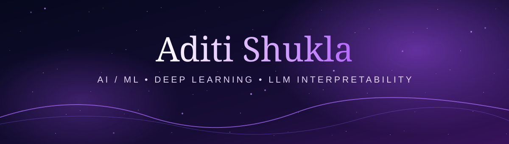

### Building reliable, interpretable and data-driven AI systems

**M.S. Data Science · The George Washington University**  
**AI/ML · Deep Learning · LLM Interpretability · Data Science**

---

### ✦ About me

I'm **Aditi Shukla**, an M.S. Data Science student at **The George Washington University**, with a B.Tech in Electronics & Communication Engineering from SRM Institute of Science and Technology. I build machine-learning systems, analyze real-world data, and investigate how language models represent information.

My interests include **LLM interpretability**, **deep learning**, **model evaluation**, **forecasting**, and **applied machine learning**.

### ✧ Technical toolkit

### ✦ Selected project work

<table>
<tr><td width="50%">

<b>Kubernetes Pod Overload Prediction</b> 
Machine-learning models for predicting resource overload from CPU and memory metrics, with an evaluation of threshold-driven scaling behavior. 
<a href="https://github.com/aditi650/kubernetes-predicting-models">Explore repository →</a>
</td><td width="50%">

<b>Data Science Salary Analysis</b> 
Exploratory analysis, statistical testing and salary prediction. Completed academic team project. 
<a href="https://github.com/aditi650/Data-Science-Salaries">Explore repository →</a>
</td></tr>
<tr><td width="50%">

<b>U.S. Retail Opportunity Dashboard</b> 
State- and sector-level retail analysis using Python data preparation and Tableau visualizations. Collaborative project. 
<a href="https://github.com/aditi650/retail_dashboard">Explore repository →</a>
</td><td width="50%">

<b>Myntra Product Feedback Analysis</b> 
Pricing, discounts, product reviews and customer-rating analysis. Academic team project. 
<a href="https://github.com/aditi650/myntra_analysis">Explore repository →</a>
</td></tr>
</table>

### ✧ Current research & work in progress

**Sparse Autoencoder Faithfulness — LLM Interpretability Capstone**  
Investigating how faithfully sparse autoencoders reconstruct and preserve language-model activations, truth-related representations and causal effects. Research includes **GPT-2 Small**, **Gemma 2 2B**, and **ReLU, TopK and JumpReLU** architectures, using reconstruction, probing and steering evaluations. **Research in progress.**

**Oil Price Forecasting**  
Developing time-series forecasting approaches for **WTI and Brent** prices using **LSTM/GRU** architectures and feature analysis. **In progress.**

**Deep Learning & Computer Vision**  
Exploring image classification using **MobileNetV2 transfer learning** and fine-tuning. [Intel scene-classification repository](https://github.com/aditi650/Machine_learning-). **Completion status not yet verified.**

### ✦ GitHub activity

---

*Exploring the space between what AI models learn, what they preserve, and how we can understand them.* ✦

