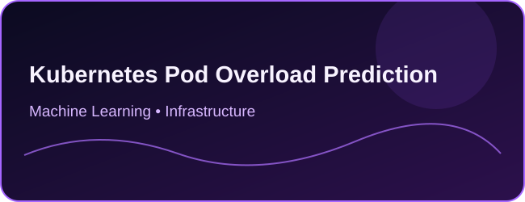
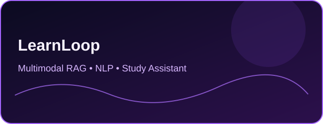
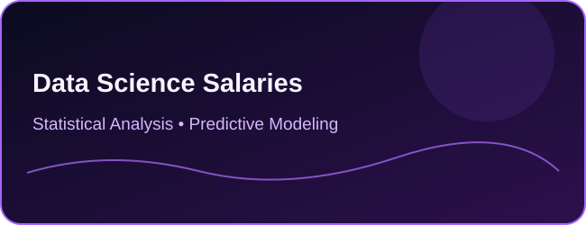
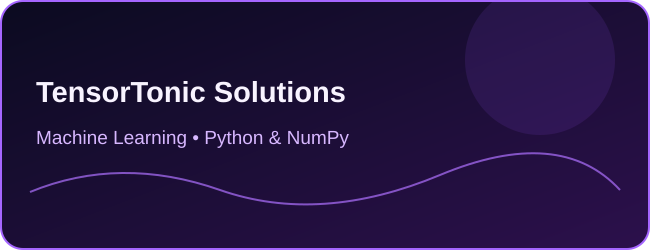

### Building reliable, interpretable and data-driven AI systems

**M.S. Data Science · The George Washington University**  
**AI/ML · Deep Learning · LLM Interpretability · Data Science**

---

### ✦ About me

I'm **Aditi Shukla**, an M.S. Data Science student at **The George Washington University**, with a B.Tech in Electronics & Communication Engineering from SRM Institute of Science and Technology. I build machine-learning systems, analyze real-world data, and investigate how language models represent information.

My interests include **LLM interpretability**, **deep learning**, **model evaluation**, **forecasting**, and **applied machine learning**.

### ✧ Technical toolkit

**Programming & Data**

**Machine Learning & Deep Learning**

**LLMs & Interpretability**

**Tools & Infrastructure**

**Visualization & Analytics**

### ✦ Projects

<table>
<tr><td width="50%">

<b>Kubernetes Pod Overload Prediction</b> 
Machine-learning models for predicting resource overload from CPU and memory metrics, with an evaluation of threshold-driven scaling behavior. 
<a href="https://github.com/aditi650/kubernetes-predicting-models">Explore repository →</a>
</td><td width="50%">

<b>LearnLoop — Multimodal RAG Study Assistant</b> 
Collaborative NLP project that ingests course materials, retrieves relevant content, and generates answers, summaries, quizzes, and flashcards using retrieval-augmented generation. 
<a href="https://github.com/caffeinated4ighs/Learn_Loop">Explore collaborative repository →</a>
</td></tr>
<tr><td width="50%">

<b>U.S. Retail Opportunity Dashboard</b> 
State- and sector-level retail analysis using Python data preparation and Tableau visualizations. Collaborative project. 
<a href="https://github.com/aditi650/retail_dashboard">Explore repository →</a>
</td><td width="50%">

<b>Myntra Product Feedback Analysis</b> 
Pricing, discounts, product reviews and customer-rating analysis. Academic team project. 
<a href="https://github.com/aditi650/myntra_analysis">Explore repository →</a>
</td></tr>
<tr><td width="50%">

<b>Data Science Salary Analysis</b> 
Exploratory analysis, statistical testing and salary prediction. Completed academic team project. 
<a href="https://github.com/aditi650/Data-Science-Salaries">Explore repository →</a>
</td></tr>
</table>

### ✦ Technical Practice

<table>
<tr><td width="50%">
 
<b>TensorTonic — Ongoing</b> 
ML algorithms and linear algebra from scratch using Python and NumPy. 
<a href="https://github.com/aditi650/TensorTonic-Solutions">Explore repository →</a>
</td><td width="50%"></td></tr>
</table>

### ✧ Projects I'm currently working on

**Sparse Autoencoder Faithfulness — LLM Interpretability**  
Researching how sparse autoencoders preserve language-model activations, truth-related representations, and causal behavior. Comparing **GPT-2 Small** and **Gemma 2 2B** with **ReLU, TopK, and JumpReLU** architectures across reconstruction, probing, and steering evaluations.

**Oil Price Forecasting — Time Series & Deep Learning**  
Building and evaluating **LSTM/GRU** forecasting approaches for **WTI and Brent** oil prices, with feature analysis and model comparisons.

---

*Exploring the space between what AI models learn, what they preserve, and how we can understand them.* ✦

